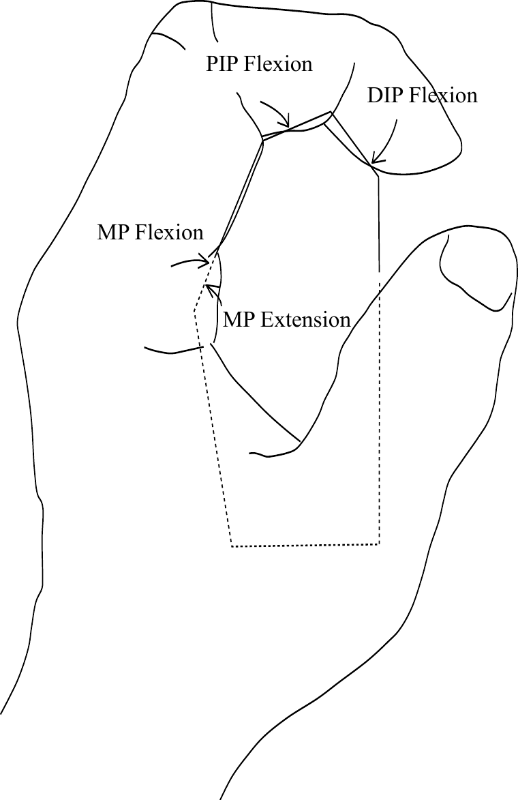

# A one-handed mobile keyboard that stays under the fingers.

Handex forms the keys to the finger actions. A finger does not move to another seat for the next character, and you do not look down at the hand to find it.

It is a proof of concept. On the inventor’s own tests, with cheap 6 mm buttons and a rough chassis, standard sentences and punctuation come out at about 20 words per minute. That is one person’s number, not a lab study. The product is not in its final form.

<form id="list-form" class="list-form" novalidate>
<label for="list-email">Email address</label>
<input id="list-email" name="email" type="text" inputmode="email" autocomplete="email" spellcheck="false" required placeholder="you@example.com">
<button type="submit">Get on the list</button>

</form>

<a href="https://handex.io">handex.io</a>

<h2 id="demo">The prototype, in one minute</h2>

<video controls playsinline preload="metadata" poster="/handex-poster.jpg">
  <source src="/handex.mp4" type="video/mp4">
</video>

One minute with the prototype. About 20 words per minute on the inventor’s own sentences, not a lab study.

## Who this page is for

- [Field notes](/field-notes/) while the eyes stay on the animal, the scope, or the count.
- [Assistive-technology labs](/labs/) that already show people specialized keyboards.
- [Researchers](/xr/) who catalog how people type in headsets.

## What this is not

It is not the first one-handed keyboard. Chorded keysets go back at least to Douglas Engelbart’s 1968 demo, and several mobile and wearable typers already exist. Handex is the gripped form that shapes the switches to the finger actions. It is not a hearing aid and not a captioning tool.
